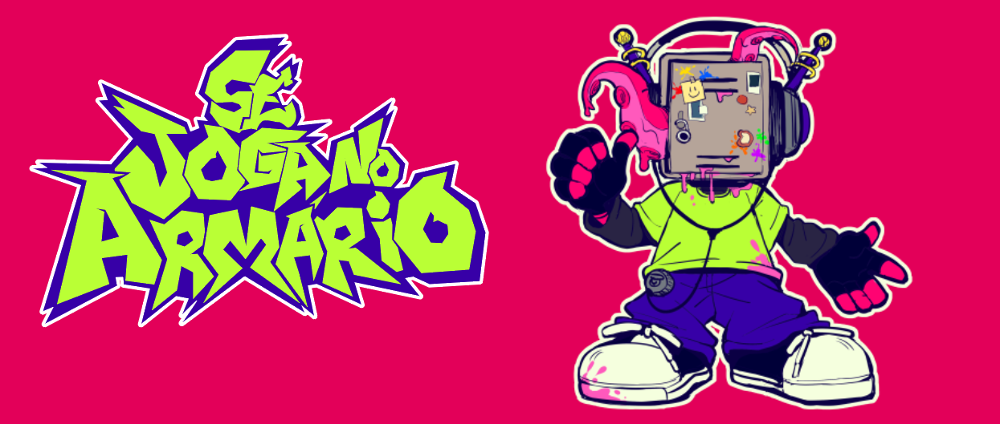
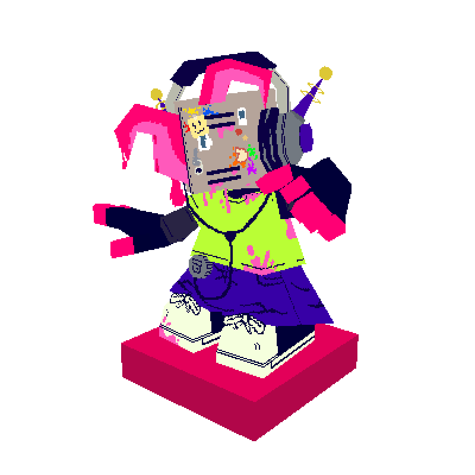
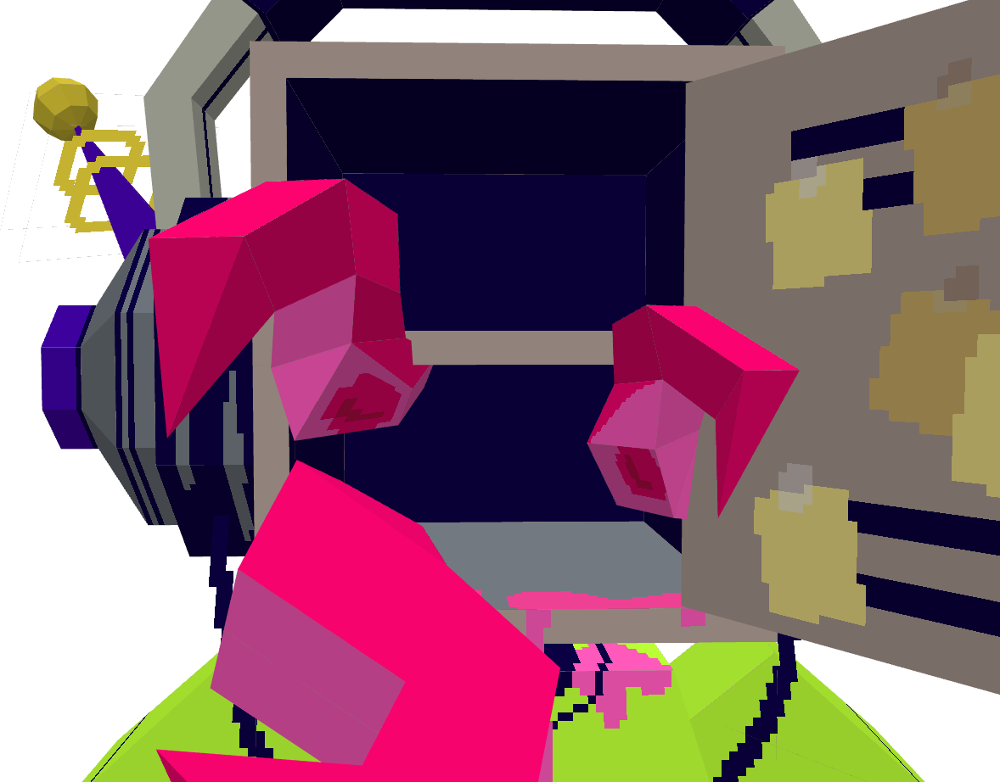
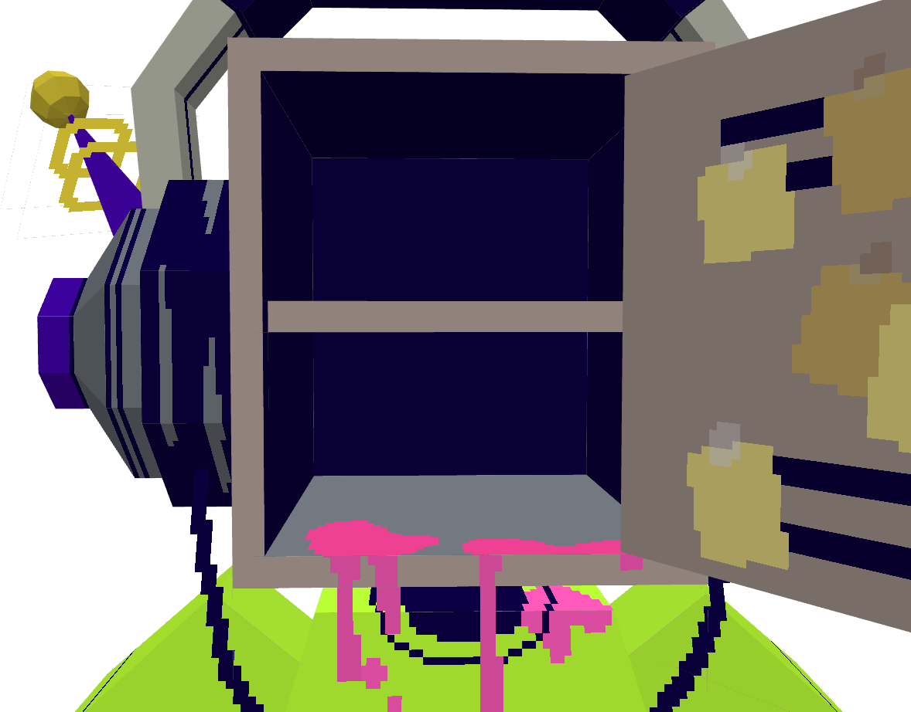

<div align="center">



# Se Joga Desktop Companion

**O Mário sai do armário e vai morar no seu desktop.**
Mascote 3D com animação procedural, física de verdade e reação à sua música — sempre por cima das janelas, nunca no seu caminho.


</div>

---

<table>
<tr>
<td width="55%" valign="top">

## O que ele faz

O Mário vive solto na sua área de trabalho. Ele respira, cochila, repara no seu cursor e dança quando toca música. Você pega, arrasta, arremessa — e a física cuida do resto: ele cai, quica e se acomoda onde parar.

Nada de clipe pré-gravado engessado: **toda pose é gerada na hora**, com molas amortecidas que dão peso e fluidez ao movimento.

</td>
<td width="45%" valign="top">

<div align="center">

</div>

</td>
</tr>
</table>

---

## Destaques

| | |
|---|---|
| **Animação viva** | Poses procedurais com inércia corporal, antecipação e follow-through. Nove personalidades de idle que se alternam sozinhas. |
| **Pega e joga** | Arraste com física real, arremesso, queda, quique e pouso. Colide com bordas do monitor e janelas. |
| **Dança na batida** | Reage à música do Windows (Media Session) ou ao áudio do sistema (loopback). |
| **Tentáculos** | Emergem da porta da cabeça, gotejam gosma rosa e seguem a física. |
| **Fica no seu canto** | Overlay transparente com clique-através: ele não bloqueia o que está embaixo. |
| **Do seu jeito** | Contorno, escala e ordem de janela configuráveis. Atalhos globais. Posição salva entre sessões. |

---

## Instalação

Baixe o instalador mais recente na página de **[Releases](https://github.com/ArchVeketo/SeJogaDesktopCompanion/releases)**, execute e pronto — o Mário aparece no seu desktop.

> Windows 10/11. Não precisa de Python nem de nada instalado.

---

## Controles

<table>
<tr><td><b>Hover</b></td><td>Ele olha para você e entreabre a porta</td></tr>
<tr><td><b>Clique esquerdo</b></td><td>Cutucada</td></tr>
<tr><td><b>Clique direito</b></td><td>Carinho</td></tr>
<tr><td><b>Botão do meio</b></td><td>Reação de surpresa</td></tr>
<tr><td><b>Arrastar</b></td><td>Segura e move (6px+); solta para posicionar. <code>Esc</code> cancela sem arremessar</td></tr>
<tr><td><b>Ctrl + Alt + S</b></td><td>Abre as configurações</td></tr>
</table>

Com a física ligada, soltar em movimento **arremessa** o Mário; soltar parado só reposiciona.

---

## Galeria

<div align="center">


&nbsp;


<br><br>

<!-- GIFS DE ANIMAÇÃO: preencher quando os previews ficarem prontos -->
<!-- Sugestão: dança (4 estilos), arraste com física, idle com personalidade -->
<i>GIFs de dança, arraste e idle chegam em breve — gerados a partir do próprio motor de animação.</i>

</div>

---

## Para desenvolvedores

Companion em Python: **Panda3D** renderiza, **PySide6** cuida da bandeja e das configurações, **Pymunk** simula a física no desktop. O motor de animação é procedural por camadas — molas por junta, cadeia de atraso nos membros e clipes autorais como dados.

```
src/sejoga/
  animation.py      Controlador de estados e composição de camadas
  anim_layers.py    Camadas aditivas (base, locomoção, música...)
  joint_springs.py  Molas por junta e cadeia de atraso
  anim_clips.py     Clipes de animação como dados
  rig.py            Catálogo do rig e poses procedurais
  physics.py        Física de tela (Pymunk)
  renderer.py       Renderizador Panda3D
  win32_overlay.py  Janela em camadas / clique-através (Win32)
```

```powershell
git clone https://github.com/ArchVeketo/SeJogaDesktopCompanion.git
cd SeJogaDesktopCompanion
pip install -e .
sejoga                        # roda a partir do código

python -m pytest              # testes
python tools/smoke_mouse.py   # janela real com perfil temporário
.\build.ps1                   # gera o pacote em dist\SeJogaCompanion\
```

Documentação técnica em [`docs/`](docs/) — comece por [STATUS_E_PROXIMOS_PASSOS.md](docs/STATUS_E_PROXIMOS_PASSOS.md). O backlog de conteúdo (animações, props, efeitos) está em [BACKLOG_CONTEUDO.md](docs/BACKLOG_CONTEUDO.md).

---

## Licença

O **código** é distribuído sob a licença **[Apache 2.0](LICENSE)**.

O personagem **Mário**, a marca **Se Joga no Armário**, o logotipo e toda a **arte** deste repositório (incluindo o diretório `assets/`) são © 2026 Se Joga no Armário — **todos os direitos reservados**. Não estão cobertos pela licença do código e não podem ser usados ou redistribuídos sem autorização por escrito.

---

<div align="center">


**Se Joga no Armário** — arte e conceito originais.

</div>
