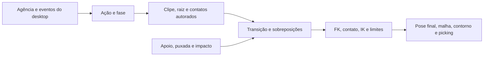

# Fluidez, rig e animação procedural do Mário

12 de novembro de 2026 · Estudo técnico baseado no [Manual Unificado](MANUAL_UNIFICADO_MARIO.md), no [Manifesto da Criatura Viva](MANIFESTO_CRIATURA_VIVA_MARIO.md) e na [investigação de footwork](ESTUDO_FOOTWORK_MARIO.md).

## O que a arquitetura atual permite e onde ela perde fluidez

O Mário já tem poses autorais, agência, fases de dança, respiração, arcos, squash/stretch, IK de braços, colisão e movimento secundário. As etapas estão divididas entre o controlador, o resolvedor e o renderer. Essa divisão explica quatro problemas que ajustes de intensidade sozinhos não resolvem.

| No código atual | Consequência a verificar na janela | Mudança de mecanismo |
|---|---|---|
| [PoseResolver](../src/sejoga/animacao/resolvedor_poses.py) guarda a pose anterior e interpola componentes HPR para o novo alvo com peso quíntico. | Uma saída rápida pode perder velocidade no instante da troca. Perto de ±180°, a diferença entre componentes pode induzir a volta longa. | Guardar pose e velocidade da transição e misturar rotações no espaço correto. Usar a pose efetivamente exibida como origem. |
| [AnimationController](../src/sejoga/animacao/controlador_animacao.py) corrige os braços e depois aplica mãos e resposta tátil. Pernas são calculadas por outro caminho. | Uma contribuição posterior pode invalidar uma restrição anterior. Braços, cabeça, bacia e botas podem discordar sobre a mesma fase do gesto. | Uma amostra por frame com pose, raiz, contatos e fase comum. Validar restrições na pose composta. |
| [Janela](../src/sejoga/render/janela.py) aplica pose, pernas e depois movimento global. [LowerBody](../src/sejoga/render/corpo_inferior.py) usa pivôs sagitais e compensa a altura pela sola. | A compensação vertical permite que um pé deslize em X/Y. Giro, escala ou suspensão posteriores podem mover a palma ou a bota que deveria estar fixa. | Calcular primeiro a transformação global prevista, converter contatos para o espaço do rig, resolver IK e publicar a mesma pose para malha, contorno e picking. |
| A [agência](../src/sejoga/animacao/agencia.py) tem metas, humor e memória de interação. Parte da performance ainda avança por janelas de tempo ou resposta instantânea ao estado. | Uma intenção pode sumir ao interromper o movimento. O comportamento perde a relação visível entre o alvo, o gesto e sua consequência. | Fazer a ação informar preparação, compromisso e recuperação à agência. Decidir se retoma a meta a partir do resultado da interrupção. |

Esses efeitos são hipóteses derivadas do fluxo do código. O experimento deve registrar cada caso em movimento para distinguir um defeito visível de uma possibilidade matemática.

## O modelo que o programa carrega

Consultei `resolve_model()` e abri o glTF no ambiente atual. O caminho efetivo é `assets/model/mario.gltf`. O arquivo tem **91 nós, 56 malhas, zero skins e zero animações**. A contagem histórica de 73 nós e 43 malhas no manual difere da contagem do arquivo carregado. A estrutura continua sendo uma hierarquia de peças rígidas. `projetoMARIO.gltf` tem 88 nós, 56 malhas, zero skins e uma animação `teste` com um canal linear. A bota é irmã de `legs` no rig em uso e o renderer a reconecta em runtime. Um retargeter humanoide que suponha tornozelo filho da canela precisa de um adaptador.

Fiz uma prova com Blender 5.2.3 LTS em modo headless. Importei o Mário, animei a rotação do objeto vazio `right-arm` em três chaves e exportei esse objeto isolado em glTF com um canal `rotation`. No Panda3D 1.10.16 com `panda3d-gltf` 1.3.0, o pivô carregou, com zero `AnimBundleNode` e zero `Character`. O export `projetoMARIO.gltf` já animado também produziu zero dos dois. Isso confirma, para esses arquivos e versões, que colocar um glTF animado na pasta e chamar `Actor.play` não resolve o playback. O formato pode ser a entrada do importador de curvas, e o renderer continua dirigindo os nós. [Blender glTF](https://docs.blender.org/manual/en/latest/addons/import_export/scene_gltf2.html) · [Panda3D Actor](https://docs.panda3d.org/1.10/python/reference/direct.actor.Actor) · [panda3d-gltf](https://github.com/Moguri/panda3d-gltf)

### Mapa semântico inicial

| Papel | Alvos no Mário | Regra de transferência |
|---|---|---|
| Raiz e centro de movimento | Raiz visual do rig e cadeia `legs`/pelve | Separar o percurso do corpo no chão da translação da bacia dentro da pose. Medir os pivôs reais. |
| Coluna e cabeça | `body → cintura → abdomen → peitoral`, `head` | Distribuir a torção em bases locais e preservar a silhueta do gabinete. Tratar a orientação da cabeça no referencial do seu pai real. |
| Braços e mãos | `right-arm → ant-arm → hand`, `left-arm → ant-arm2 → hand2` | Transferir trajetória da palma e plano do cotovelo. Aplicar limites e resolver a torção da mão separadamente. |
| Pernas e botas | `coxa-*`, `joelho-*`, `canela-*`, `left-feet`, `right-feet` | Transferir alvo do tornozelo e direção do joelho. Definir sola, calcanhar e ponta por marcadores locais. Usar a cadeia efetiva de `LowerBody`. |
| Elementos do armário | Porta, fones, cabo, antenas, dedos e tentáculos | Autorá-los com eventos e curvas próprios. Usar gestos da performance como referência de ritmo quando houver correspondência. |

Na importação, identificar o canal pelo índice dentro do arquivo e vincular ao rig de destino por caminho hierárquico e papel semântico validado. O asset contém dezenas de nós chamados `cuboid` e outros nomes repetidos. Para os grupos animáveis, comparar a hierarquia, o transform de repouso e os comprimentos com o rig efetivamente carregado. Falhar com diagnóstico quando uma ligação obrigatória for ambígua. Testar o mapeamento com rotações isoladas em cada eixo, em duas vistas, e com a FK de [cinematica.py](../src/sejoga/nucleo/cinematica.py) comparada à cena. O oráculo atual serve de base, e o caminho especial das pernas exige uma medição própria.

Para mocap, calcular o delta em relação à pose de repouso da origem, trocar a base local e compor esse delta com o repouso do destino. Com quaternions ativos e produto nessa ordem, `delta = inverse(q_origem_repouso) * q_origem_frame` e `q_destino_frame = q_destino_repouso * (C * delta * inverse(C))`, sendo `C` a rotação da base local da origem para a do destino. Converter a orientação final para a convenção local do aplicador uma única vez. Se a saída for HPR, obter o delta esperado pelo renderer pela diferença em relação ao HPR de repouso na mesma representação, com escolha de ramo contínua. Resolver alvos de contato no destino depois dessa transferência. Um giro de bacia humano e um giro do gabinete têm a mesma intenção, mas a distância e o arco das botas precisam caber no Mário. [Especificação glTF 2.0](https://registry.khronos.org/glTF/specs/2.0/glTF-2.0.html#animations) · [Footskate Cleanup](https://research.cs.wisc.edu/graphics/Gallery/kovar.vol/Cleanup/)

## Bibliotecas e ferramentas por problema

| Ferramenta | O que resolve neste projeto | Decisão de integração |
|---|---|---|
| **Blender e `bpy`** | Keyframes, curvas, constraints de autoria, edição de mocap e bake de transforms avaliados. Pode animar os pivôs como objetos. | Primeira ferramenta de autoria. Script offline gera dados de um clipe por Action, com raiz e eventos. Para constraints usar bake visual e conferir a saída. Blender fica no fluxo de produção de assets. [Blender glTF e amostragem](https://docs.blender.org/manual/en/latest/addons/import_export/scene_gltf2.html) |
| **SciPy Spatial e Optimize** | `Rotation`, `Slerp`, `RotationSpline` e mínimos quadrados com limites. Útil para retargeting, comparação de rotações, ajuste offline de bacia e reconstrução de contatos. | Usar em ferramentas e como oráculo do sampler. No host, SciPy 1.18.1 interpolou yaw de +170° a −170° passando por 180°. Preservar curvas e tangentes glTF quando existirem, em vez de refazer toda animação com uma spline global. [Slerp](https://docs.scipy.org/doc/scipy/reference/generated/scipy.spatial.transform.Slerp.html) · [RotationSpline](https://docs.scipy.org/doc/scipy/reference/generated/scipy.spatial.transform.RotationSpline.html) · [least_squares](https://docs.scipy.org/doc/scipy/reference/generated/scipy.optimize.least_squares.html) |
| **Panda3D e `panda3d-gltf`** | Carregam e aplicam a cena, projetam alvos e oferecem APIs de mistura para assets que se tornam `Actor`. | Reusar os NodePaths e o aplicador atual. O teste do rig rígido mostrou que o caminho via `Actor` exigiria outro pipeline de asset. [Panda3D Actor](https://docs.panda3d.org/1.10/python/reference/direct.actor.Actor) |
| **IK analítica em Python e FK do projeto** | Encontra a flexão de duas juntas por geometria e posiciona a dobra no plano definido pelo alvo e pelo polo do joelho. | Primeiro solver para um pé. Reusar a álgebra de cena, limitar o alcance e manter o polo estável perto da extensão. Resolver a orientação da bota a partir da sola/ponta. |
| **IKPy** | Resolve uma cadeia numérica, com posição, orientação, pose inicial e limites, usando SciPy. | Comparador offline quando a IK de duas juntas for insuficiente. Exige descrever o rig em elos e eixos de IKPy. Um six-step com quatro contatos requer ainda coordenar a bacia e as cadeias. [IKPy](https://github.com/Phylliade/ikpy) |
| **MediaPipe Pose Landmarker** | Estima 33 pontos a partir de vídeo, incluindo calcanhar e ponta do pé. | Usar para rascunhar trajetórias quando houver apenas vídeo. Revisar oclusões, torção, profundidade e contatos no Blender. Filmar de dois ângulos quando a mão ou a bota some atrás do corpo. [Google AI Edge](https://developers.google.com/edge/mediapipe/solutions/vision/pose_landmarker) |
| **Pymunk** | Posição e velocidade do corpo 2D, gravidade e colisão com o desktop. | Continuar usando o passo físico atual. Entregar velocidade relativa, apoio e evento de impacto ao controlador para modular reações autorais. [API Pymunk](https://www.pymunk.org/en/latest/pymunk.html) |
| **ozz-animation** | Runtime C++ de amostragem, mistura e IK. | Referência para desempenho e composição. Um binding e a conversão do rig só se justificam se a medição apontar o sampler como gargalo. [ozz-animation](https://github.com/guillaumeblanc/ozz-animation) |
| **MuJoCo** | Dinâmica 3D articulada, contatos e atuadores. | Opção de laboratório para equilíbrio dinâmico, apoio complexo e recuperação de queda caso isso vire objetivo próprio. Exige um modelo de colisão e controle. [MuJoCo](https://mujoco.readthedocs.io/en/stable/overview.html) |

Motion matching entra depois que houver um acervo de performances e transições suficiente para buscar poses por trajetória, velocidade e apoio. Com o repertório atual, a intenção pode escolher entre entrada, frase, interrupção e recuperação explícitas. [Learned Motion Matching, Ubisoft La Forge](https://staticctf.ubisoft.com/J3yJr34U2pZ2Ieem48Dwy9uqj5PNUQTn/2EVXGPN6ynTrrJaaAUHmZS/060e223cce6a84e47e925105cac5e17f/Learned_Motion_Matching.pdf)

## O que programar no runtime

1. **Um contrato de clipe para o caminho existente.** Manter tempo em segundos, ou fase em batidas para dança, e declarar conversão. Importar offline o glTF de autoria e um sidecar com marcadores de gesto e contatos. Um primeiro conversor pode aceitar rotações e translações de pivôs reconhecidos com pistas bakeadas, e emitir um formato já validado para Python carregar uma vez. Um contato precisa de ponto local, superfície, intervalo e modo: fixo, pivô ou slide. Marcar quais canais estão em transformação absoluta local e quais são deltas. Preservar o modo de interpolação aceito e reportar canal ou modo que o conversor ainda não suporta.
2. **Uma transição que carrega movimento.** Guardar os dois últimos frames exibidos e o tempo entre eles. Na troca, estimar velocidade linear da raiz e velocidade angular relativa de cada junta. Amostrar o novo clipe e aplicar um offset de posição/orientação cuja amplitude e velocidade convergem a zero. Comparar um crossfade de duas amostras vivas com inertialização por offset. Para um pé fixo, a fase e o ponto de apoio decidem se ele fica travado ou se a saída vira um novo passo. Para drag ou queda, soltar o apoio imediatamente e usar a velocidade atual na reação. A memória de velocidade serve à transição de poses autorais. [Inertialization, David Bollo](https://media.gdcvault.com/gdc2018/presentations/bollo_david_inertialization_high_performance.pdf)
3. **Um dono para cada restrição e um espaço para cada alvo.** Pose autoral e camadas produzem transforms locais. O solver trabalha com alvo do desktop ou da superfície convertido à cena 3D usando raiz, yaw e escala do frame. Corrigir a bacia dentro da faixa alcançável, resolver o membro, aplicar limites e medir o resíduo após os limites. Se duas restrições forem incompatíveis, preservar o agarre ou apoio principal e ajustar a pose ou liberar o secundário de forma explícita. O contato deve persistir mesmo quando o HWND muda de origem. O contorno e o hit-test usam a pose final.
4. **Um relógio de ação e eventos.** Amostrar usando tempo decorrido. Emitir marcadores cruzados entre o frame anterior e o atual, inclusive quando há salto de frame ou volta do loop. Separar o avanço da física em passo fixo da amostragem visual. Ações lentas, acentos e interrupções devem funcionar a 30 e 60 FPS e sob um frame atrasado. Gatilhos de agência usam acontecimentos como interesse detectado, objetivo alcançado, interrupção e pouso, além do tempo decorrido.
5. **Procedural orientado pela ação.** O clipe diz a forma do gesto. A camada procedural decide a direção do olhar, o alcance da mão, o apoio disponível e o efeito da puxada real. Um parâmetro de direção vira alvo em cena, um impacto vira evento com normal e velocidade, e um acento vira marcador temporal. Isso dá variação contextual ao mesmo gesto. Fones, cabo e apêndices respondem à trajetória com atraso e limites locais. Em apoios, encerrar a composição com a restrição física ou visual que o gesto exige.

## Os 12 princípios na mesma ação

A tabela usa uma sequência só para demonstrar os doze simultaneamente. O Mário vê algo, prepara uma passada, é agarrado no meio, resiste e aterrissa. Cada mecanismo tem uma parte autoral e uma aplicação em runtime. A mesma revisão vale para idle, dança, sono e gestos. [John Lasseter, *Principles of Traditional Animation Applied to 3D Computer Animation*](https://www.cs.cmu.edu/afs/cs/academic/class/15462-f13/www/lec_slides/Lesseter.pdf)

| Princípio | Como entra no código e no clipe | O que observar |
|---|---|---|
| Compressão e extensão | Usar uma curva autoral acionada por carga ou impacto. Aplicar escala orientada pelo contato em um pivô, redistribuir volume e resolver apoios depois. | Peso no impacto, sola firme, dobradiça e mão ainda alinhadas. |
| Antecipação | Marcador de preparação com transferência de peso e olhar prévio. Permitir interrupção da preparação pelo mouse. | A intenção aparece antes do primeiro passo. |
| Encenação | Selecionar direção e variante da pose pelo alvo e pela projeção. Usar alvos de mão que preservem o rosto e a porta na vista padrão. | A ação é legível no tamanho real, inclusive em 3/4. |
| Pose a pose e ação direta | Autorar poses de passagem, carga, resistência e pouso como pontos de controle. Integrar cabo e apêndices continuamente entre elas. | As poses fortes sobrevivem à resposta procedural. |
| Continuidade e sobreposição | Carregar velocidade no corte de estado, defasar tronco, fones e cabo, manter o agarre no referencial apropriado. | O corpo muda de plano e as pontas completam o movimento. |
| Aceleração e desaceleração | Usar tangentes de animação ou velocidades de entrada e saída. Usar pausa explícita onde a pose pede sustentação. | A mão acelera para resistir e desacelera para assentar, sem freada a cada chave. |
| Arcos | Autorar a trajetória do efetor em 3D e corrigir com IK. Passar polo e direção do movimento ao solver. | Pé livre e pulso desenham curvas coerentes também de lado. |
| Ação secundária | Sobrepor olhar, dedos ou porta com máscara e gatilho do gesto principal. | A resposta secundária dá contexto e deixa o gesto principal legível. |
| Timing | Marcadores de preparação, acento, contato e recuperação em segundos ou batidas. Impacto usa o instante real de contato. | Antecipação e reação têm ritmos distintos e o acento bate com a música quando aplicável. |
| Exagero | Autorar uma pose extrema de resistência, com linha de ação mais forte. Limitar a correção aos apoios e à anatomia necessária. | A reação é expressiva e o gabinete mantém sua identidade. |
| Desenho sólido | FK e IK a partir do repouso medido, limites de articulação, contato de sola/palma e verificação de interpenetração. | O peso parece sustentado e os volumes continuam articulados. |
| Apelo | Agência escolhe um gesto com intenção e consequência. A reação retoma o alvo ou mostra que o Mário mudou de ideia. | É possível ler curiosidade e teimosia sem explicação verbal. |

## Ordem de implementação e prova

1. **Importar e interromper um gesto de braço.** Autorar no Blender um olhar seguido de alcance com antecipação e recuperação. Exportar os pivôs de cabeça e braço, amostrar no controlador e interromper em três pontos do gesto. Comparar a reprodução com o Blender em repouso, chaves e meios de intervalo. Na janela, comparar a transição atual com a que carrega velocidade. O mesmo gesto precisa tolerar direção diferente sem refazer as chaves.
2. **Toprock com um pé travado.** Reutilizar o importador e adicionar raiz, fase, ponto de sola e contato. Testar o cruzado descrito no estudo anterior, apoio em uma superfície, parada no meio do passo e saída para drag. Registrar deriva projetada, alcance, penetração, troca de apoio e a pose no frame do corte. Se a planta fixa deslizar ao mover ou redimensionar a janela, revisar a cadeia de espaços antes de aumentar o número de clipes.
3. **Uma reação completa à interrupção.** Ligar o evento de agarre à intenção, manter o ponto preso, preparar o pouso com base na aproximação e registrar o impacto. Reusar o pipeline para queda, levantar e voltar à ação. Se houver quebra visível, identificar o frame, o alvo e a camada que escreveu por último.
4. **Aumentar repertório e apoios.** Um segundo clipe importado sem alteração do controlador prova a facilidade de integração. Depois testar apoio de mão, duas pernas ou six-step. Só então medir a necessidade de IK numérica de corpo inteiro, de um rig deformável ou de outro runtime.

Revisar cada entrega com gravação contínua na janela real a escala normal e duas vistas de diagnóstico. Gravar estado, fase, posição de raiz, alvo e erro de contato, velocidade na troca e tempo de CPU por etapa. Medir mediana e p95 antes e depois com a mesma cena. Usar testes de infraestrutura para importação, coordenadas, frames perdidos, limites e consistência da pose. Verificar expressão, arcos, encenação e apelo na gravação. Seguir o Manual Unificado para `tools/smoke_mouse.py --physics`, entrada nativa e executável quando as mudanças chegarem ao runtime.

Neste estudo foram verificados o asset carregado, a exportação de um canal rígido, o comportamento do loader Panda para os dois casos animados sem skin e um exemplo de interpolação por quaternion. A prova do Blender foi feita em arquivos temporários. A importação no controlador, os contatos 3D e a avaliação de fluidez na janela ainda são etapas de implementação.
